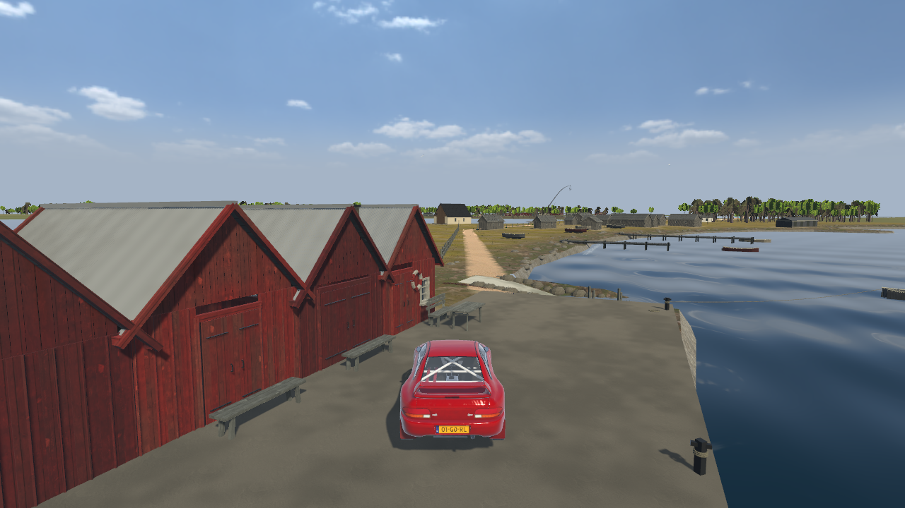
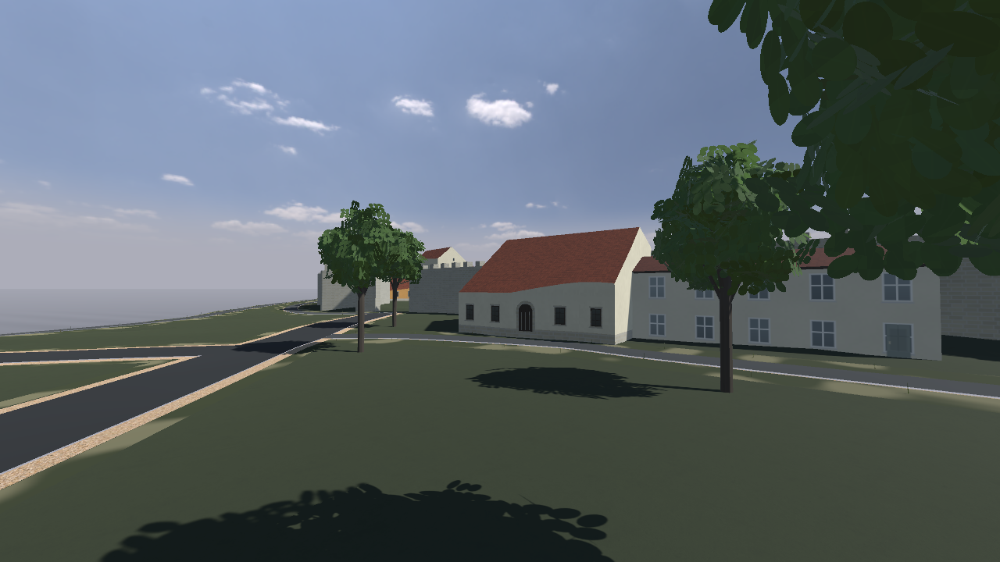
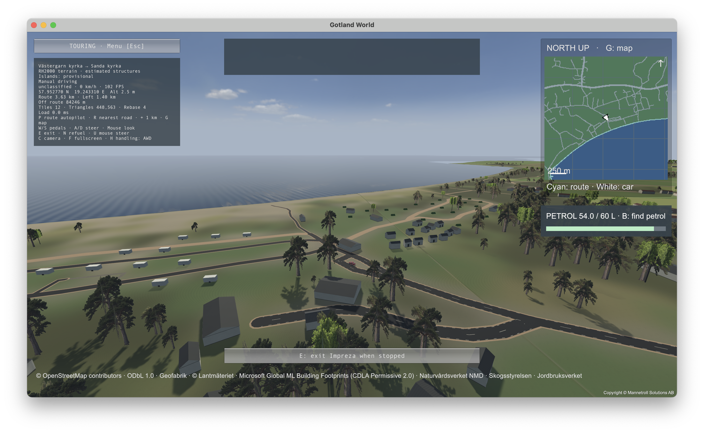
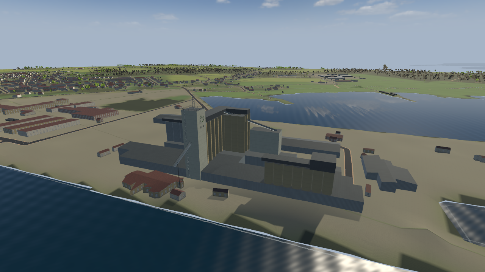
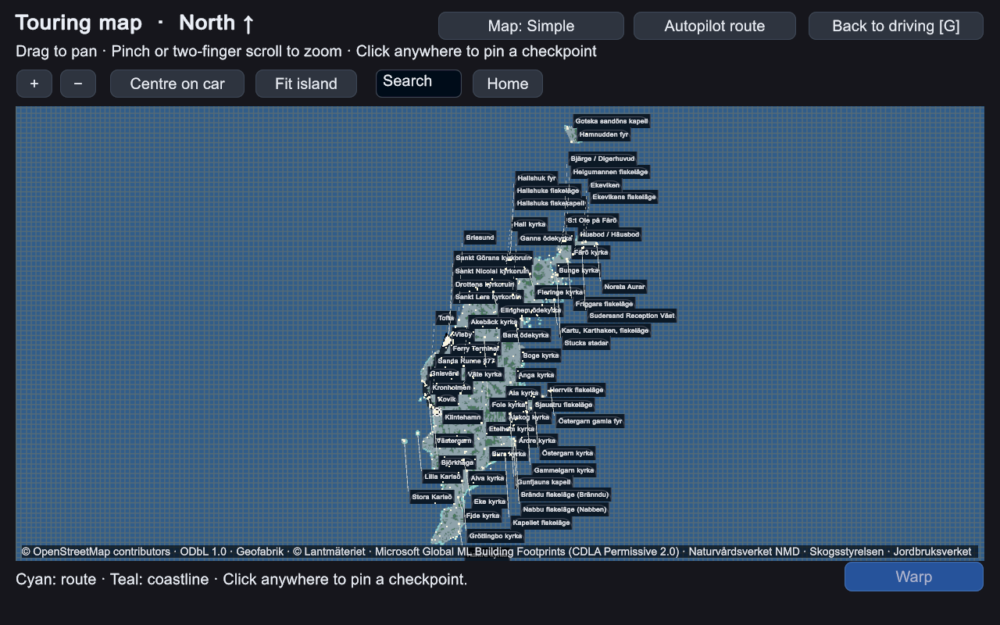
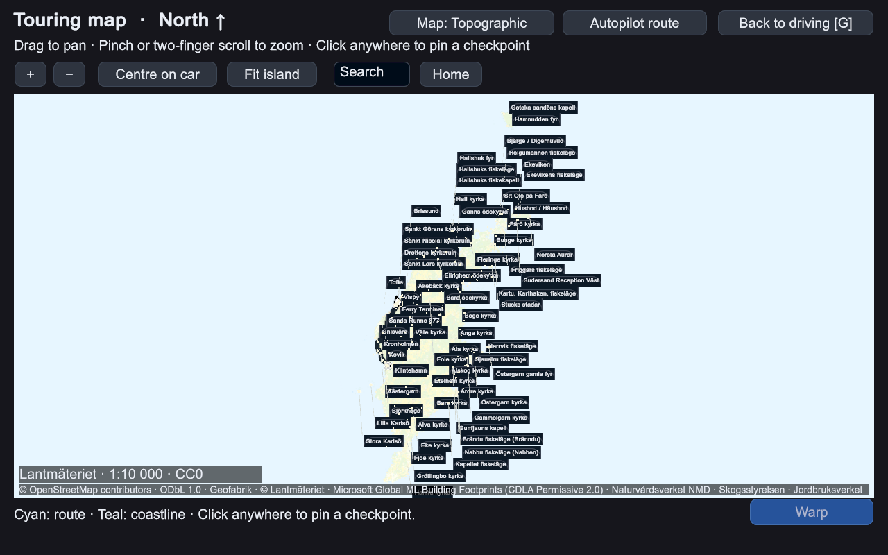

# Gotland World

**Take the coastal road. Look around. Stop wherever curiosity takes you.**

Drive and explore Gotland and Fårö, visit Visby and coastal landmarks, or let autopilot take you on a tour. Gotland Ring is included for circuit driving.

**[Watch the Impreza trailer](https://mannetroll.github.io/gotlandgame/)** · **[Downloads](https://github.com/mannetroll/gotlandgame/releases/latest)** · **[Installation guide](INSTALL.md)**

This public repository contains player documentation, screenshots, a trailer and credits. The compiled games are attached to Releases. No game source code, Unity project or development history is included.

<table>
  <tr>
    <td width="50%"> <strong>Kovik — quay, Impreza and chapel</strong></td>
    <td width="50%"> <strong>Visby Domkyrka</strong></td>
  </tr>
  <tr>
    <td width="50%"> <strong>Sudersand Väst — from above</strong></td>
    <td width="50%"> <strong>Klintehamn harbour</strong></td>
  </tr>
  <tr>
    <td width="50%"> <strong>G map — Simple view</strong></td>
    <td width="50%"> <strong>G map — Topographic view</strong></td>
  </tr>
</table>

## Trailer

[Watch the Impreza trailer](https://mannetroll.github.io/gotlandgame/) with sound, directly in your browser on iPhone or desktop. Real 1080p game footage features roadside drive-bys at Kovik and Sanda, a close tracking shot, Kovik’s red huts and concrete quay, and the sea at Tofta. Recorded in the macOS development preview with the car’s engine and coastal ambience. These locations and the Impreza are included in v0.1.1.

**Points of interest (POIs) on the G map**

| Category | Entries | Examples / description |
|---|---:|---|
| Churches, chapels & ruins | 104 | Visby Cathedral, Kovik chapel, Roma abbey |
| Lighthouses & navigation lights | 94 | Coastal towers, harbour lights and leading lights |
| Fishing villages & harbours | 78 | Kovik, Helgumannen, Grynge |
| Beaches & bathing places | 31 | Seaside and lakeside swimming spots |
| Fuel stations | 28 | 24 petrol stations and 4 biogas-only sites |
| Rauks | 21 | Limestone formations: Digerhuvud, Folhammar, Hoburgsgubben |
| Resorts & accommodation | 7 | Sudersand, Tofta Resort, Surflogiet |
| Other landmarks & places | 30 | Visby, Stora Karlsö, Stora Torget, Visby Airport, Lekarve and Snäckbacken |

Counts refer to map entries; some locations have more than one entry.

## Downloads

Download **every file for your platform** into the same folder and keep their names unchanged. The complete world uses 5.53 GB installed on macOS and around 8 GB on Windows. GitHub's per-file limit requires multiple parts; the disk image or installer reads them together.

| Platform | Download | Open after downloading all parts |
|---|---|---|
| macOS 12 or later, Apple Silicon | [Disk image](https://github.com/mannetroll/gotlandgame/releases/download/v0.1.3/GotlandWorld-v0.1.3-macOS-arm64.dmg) · [Part 2](https://github.com/mannetroll/gotlandgame/releases/download/v0.1.3/GotlandWorld-v0.1.3-macOS-arm64.002.dmgpart) · [Part 3](https://github.com/mannetroll/gotlandgame/releases/download/v0.1.3/GotlandWorld-v0.1.3-macOS-arm64.003.dmgpart) | The `.dmg` file |
| Windows 10 22H2 (build 19045) or Windows 11, x64 | [Setup](https://github.com/mannetroll/gotlandgame/releases/download/v0.1.3/GotlandWorld-v0.1.3-Windows-x64-Setup.exe) · [Data 1](https://github.com/mannetroll/gotlandgame/releases/download/v0.1.3/GotlandWorld-v0.1.3-Windows-x64-Setup-1.bin) · [Data 2](https://github.com/mannetroll/gotlandgame/releases/download/v0.1.3/GotlandWorld-v0.1.3-Windows-x64-Setup-2.bin) · [Data 3](https://github.com/mannetroll/gotlandgame/releases/download/v0.1.3/GotlandWorld-v0.1.3-Windows-x64-Setup-3.bin) · [Data 4](https://github.com/mannetroll/gotlandgame/releases/download/v0.1.3/GotlandWorld-v0.1.3-Windows-x64-Setup-4.bin) | The `Setup.exe` file |

[SHA-256 checksums](https://github.com/mannetroll/gotlandgame/releases/download/v0.1.3/SHA256SUMS) cover both platforms. See [installation instructions](INSTALL.md) for verification and first-launch details. Allow at least 18 GB free on macOS or 25 GB on Windows while downloading and installing. No Unity Editor, .NET installation, account or geographic downloads are required to play.

Use the named game files under **Releases → Assets**. GitHub's automatic **Source code (zip/tar.gz)** links contain only this documentation repository; they are not game downloads.

## What’s new in v0.1.3

- Detailed Lantmäteriet 1:10,000 maps across Gotland; map zoom is remembered when reopening with G.
- More buildings, laser-based road grading and smoother road-to-terrain joins.
- Visby Airport and Snäckbacken destinations.
- Corrected Kovik shoreline, boathouse orientation and quay edges; improved scenery grounding.
- Forests mix broad green crowns, conifers and taller leafy trees.
- Hold **Up + L** while on foot to run with one hand.
- Updated Apple Silicon download and one Windows installer for Windows 10 and Windows 11.

## Play

Touring starts near Fiskarporten in Visby. Explore roads and landmarks, use the G map to search destinations and warp, or choose an autopilot route. Open Escape to switch to Gotland Ring.

| Key | Action |
|---|---|
| W / Up · S / Down | Accelerate · brake |
| A / D or Left / Right | Steer |
| X | Brake into reverse; release the accelerator first |
| Mouse · right-click | Look around · centre view |
| U | Toggle mouse steering |
| P | Join the nearest autopilot-route point and drive |
| R | Recover to the nearest drivable road |
| G | Open or close the touring map |
| + | Jump one kilometre along the route |
| C | Cycle cockpit, bonnet, follow and drone cameras |
| Y · T | Change car · paint where supported |
| H | Switch AWD / Arcade handling |
| B · N | Find a petrol station · refuel when stopped at a pump |
| E | Exit the stopped Impreza · enter it when nearby |
| Arrow keys on foot · mouse | Walk · look around |
| Up + L on foot | Run |
| M · F | Toggle sound · fullscreen |
| Escape | Pause, settings and driving mode |

On Gotland Ring, autopilot uses Cmd+P on Mac or Ctrl+P on Windows; fullscreen uses Cmd+F / Ctrl+F. F3 opens driving settings, Z switches to the training area and Home restarts the lap (Fn+Left on compact Mac keyboards).

This is a prototype. Buildings and scenery combine mapped geometry, measurements and estimated details. Autopilot is experimental and can drive very fast. Some offshore terrain is provisional. The game is not a navigation or road-safety tool.

## Credits and use

This is an unofficial fan-made prototype, not affiliated with or endorsed by GotlandRing, Subaru Corporation or their affiliates.

The included car models use **CC BY-NC 4.0**. Builds containing them are for **noncommercial use**. Keep the licence and attribution files with redistributed copies. The original software's MIT licence does not replace separate asset, data or Unity runtime terms.

- [Third-party notices and data credits](THIRD_PARTY_NOTICES.md)
- [Original software licence](LICENSE)
- [Microsoft building-data licence](LICENSE-CDLA-Permissive-2.0.txt)

Both downloads are v0.1.3. The macOS.22 update reduces the installed macOS app by 35.5%, adds the Plesse instrument cluster with RPM on the right, and displays the version on the HUD. The Windows installer remains based on macOS.21; its inherited internal player version may display v0.3.3.

## Open data and reusable assets

| Name | Size | Type | Description |
|---|---|---|---|
| Lantmäteriet | 64GB | `.copc.laz`, `.tif` | Laser point clouds, GeoTIFF terrain elevations and raster maps. |
| Trafikverket / NVDB | 2MB | `.json` | Road geometry and measured road-width records. |
| OpenStreetMap / Geofabrik | 900MB | `.osm.pbf` | Sweden map extract: roads, paths, coastlines, buildings and place names. |
| Naturvårdsverket | 2.7GB | `.zip` | Archives containing GeoTIFF land-cover rasters. |
| Skogsstyrelsen | 2.3GB | `.mrf`, `.lrc`, `.idx` | Tree-height raster files. |
| Jordbruksverket | 66MB | `.geojson` | Agricultural field and parcel boundaries. |
| Microsoft Building Footprints | 9MB | `.csv.gz` | Compressed building outlines. |
| Copernicus DEM | 16MB | `.tif` | GeoTIFF elevation rasters used for offshore islands. |
| Poly Haven / ambientCG | 160MB | `.jpg`, `.png`, `.zip` | Texture downloads for the Kovik material set. |
| **Total** | **≈70.2GB** | | |

Sizes are rounded estimates in MB or GB (decimal units), based on cached source files and download
manifests; archives are counted in their downloaded, compressed form. These are
source-data volumes, not the installed game size. Small website references and
other separately sourced assets are excluded.

## Agent-driven development

Human prompts direct Codex's implementation and verification work. **Approximate development-session time with Codex: 39 hours**.

This is elapsed session time, including agent work, downloads and builds, with overlapping chats counted once. The figure is based on four saved Codex conversation logs and covers this phase only; later release work is not included.

